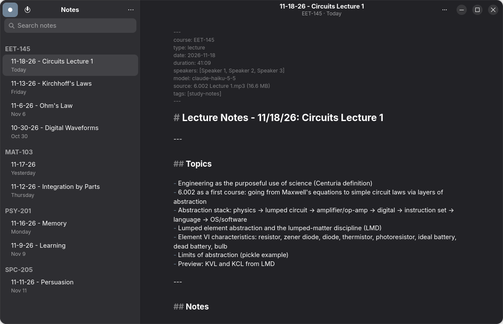
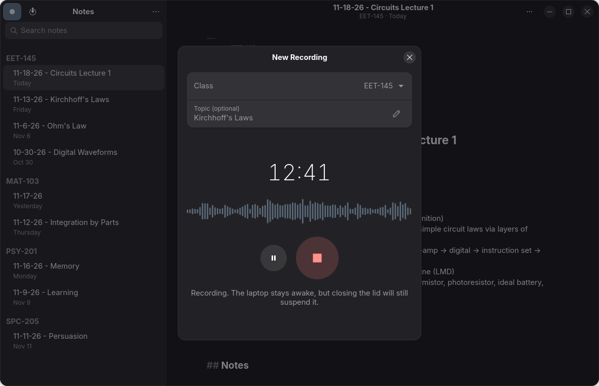
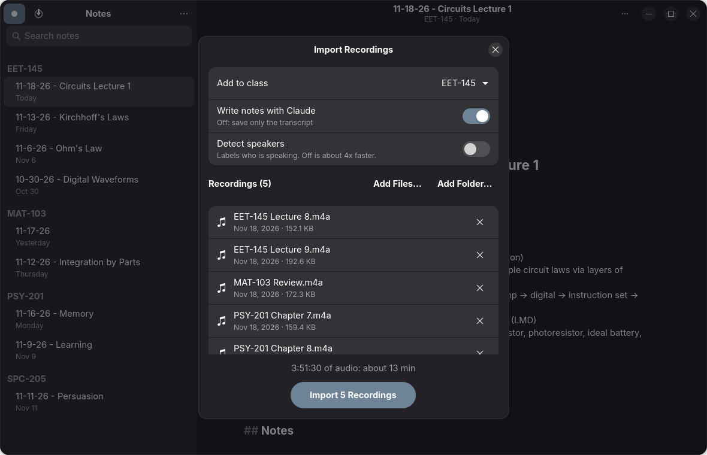
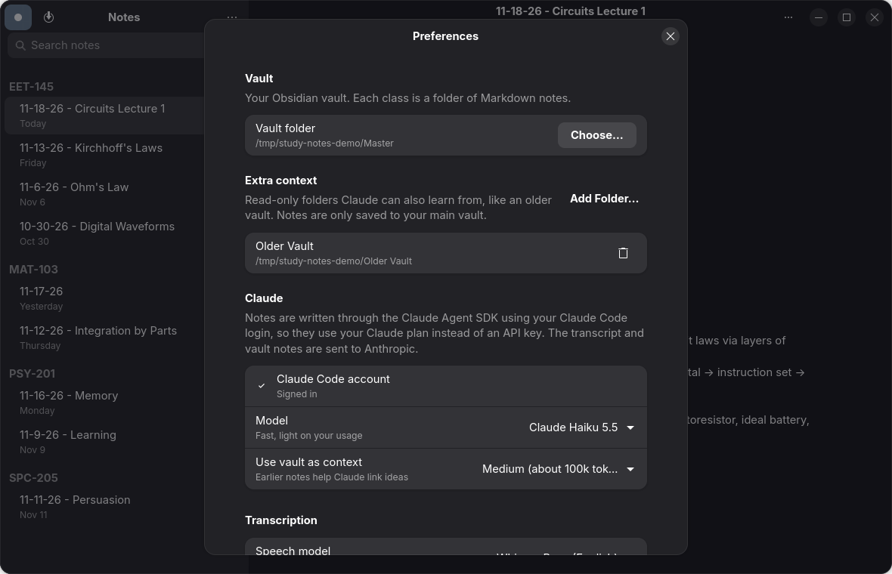
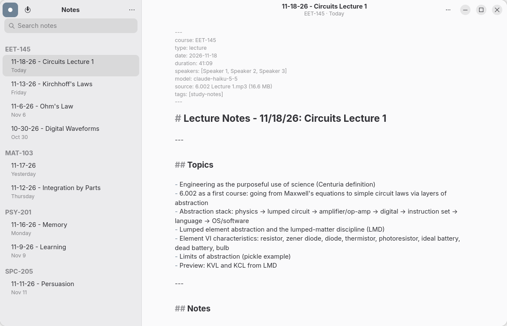
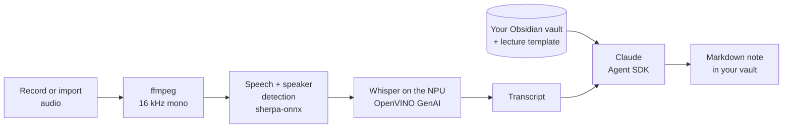

<div align="center">


# Study Notes

**Record a class. Get notes that read like *you* wrote them.**

Local speech-to-text on your Intel **NPU**, speaker detection, and notes written by **Claude** from your own
**Obsidian** vault, in your template and your style.

<p>
  
  
  
  
</p>



</div>

---

## Why

Taking notes in class means choosing between *listening* and *writing*. Study Notes does the writing, and
unlike a generic "AI summary" it works from **your** notes:

- It reads your vault, so it uses **your terminology and spelling** and links to what you already know.
- It follows **your lecture template** (`Topics / Notes / Questions`) and your voice: terse bullets, bold key terms, math.
- Transcription runs **on your machine**. Audio never leaves the laptop. Only the *transcript and your notes* go to
  Claude, and only when you ask for notes.
- It uses your **Claude subscription** through the Claude Code login. No API key, no per-token bill.

## Features

| | |
|---|---|
| **Record** | Microphone capture with a live waveform, pause/resume, and the laptop kept awake while it records. |
| **Import** | Drop in files or **whole folders** of old recordings (any audio/video format). Dates come from the files, duplicates are skipped, your originals are never touched. |
| **Fast local transcription** | OpenVINO Whisper on the **NPU** (falls back to GPU, then CPU): about 26x realtime. |
| **Speakers** | Detects who is speaking, lets you name them once, and merges phantom speakers automatically. Or switch it off for ~4x faster imports. |
| **Notes in your style** | Claude gets your vault as context, matches your template, fixes mangled technical terms, flags uncertainty with `(?)`, and puts homework first. |
| **Obsidian-native** | Plain Markdown in your vault's own layout (`School/<COURSE>/Lectures/M-D-YY.md`), frontmatter, `[[wikilinks]]`, collapsed transcript callout. Edit in Obsidian or in the app. |
| **A real editor** | Live Markdown styling, autosave, Ctrl+click links, search, rename, rename speakers, **regenerate** notes, trash with Undo. |
| **Honest about time** | Before a big import it tells you how long it will take, and warns you to plug in. |
| **GNOME-native** | Pure GTK4 + libadwaita. Follows your light/dark theme and accent colour. |

<table>
<tr>
<td width="50%"><br><sub><b>Record</b> with a live waveform</sub></td>
<td width="50%"><br><sub><b>Import</b> a folder, see the time estimate first</sub></td>
</tr>
<tr>
<td width="50%"><br><sub><b>Preferences</b>: vault, extra context, model, devices</sub></td>
<td width="50%"><br><sub>Follows the <b>light</b> theme too</sub></td>
</tr>
</table>

<sub>Demo note generated from MIT OpenCourseWare 6.002 <i>Circuits and Electronics</i> (2003), Lecture 1, licensed
<a href="https://creativecommons.org/licenses/by-nc-sa/3.0/us/">CC BY-NC-SA 3.0</a>.</sub>

## How it works



Two processes: the GTK UI runs on your system Python, and a separate worker in a virtualenv runs OpenVINO,
sherpa-onnx and the Claude Agent SDK. A crash in the AI stack never takes the window down.

## Performance

Measured on an Intel Core Ultra 5 325 (Panther Lake NPU), plugged in, with a real 41-minute lecture:

| | Time |
|---|---|
| Whisper on the NPU | **~26x realtime** (37 min of audio in 86 s) |
| Whole lecture, speaker detection on | ~9 min |
| Whole lecture, speaker detection **off** | **~2 min** |
| Speech detection (Silero VAD) | 41 min in 7 s |
| Peak memory | ~1.4 GB |

Speaker detection is the slow step (it runs on the CPU). For a big folder of old recordings, import transcripts
first with it off, then **Regenerate Notes** on the lectures you care about.

## Requirements

- Linux with **GNOME** (developed on CachyOS / Arch, GNOME 51), **libadwaita ≥ 1.8** for the Shortcuts dialog
  (older versions work with a fallback).
- An **Intel NPU** is recommended (Core Ultra); GPU and CPU work, just slower.
- **Python 3.14** (wheels are installed into a project venv).
- [**Claude Code**](https://docs.claude.com/en/docs/claude-code) installed and signed in (`claude`, then `/login`), on a
  plan that includes it.
- **Obsidian** is optional but it's the point: the app reads and writes a normal folder of Markdown.

System packages for a source install are listed under **Install → From source**.

## Install

### Flatpak (recommended)

Everything is bundled: the NPU driver, ffmpeg, the Python stack, the speech and speaker models, and Claude's CLI.
You only need `flatpak`, `flatpak-builder`, and the NPU kernel driver (`intel_vpu`, in any recent kernel).

```bash
git clone https://github.com/AJXD2/study-notes.git
cd study-notes
flatpak install --user flathub org.gnome.Platform//51 org.gnome.Sdk//51
flatpak-builder --user --install --force-clean build-dir io.github.ajxd2.StudyNotes.yml
flatpak run io.github.ajxd2.StudyNotes
```

The build downloads about 1 GB and compiles ffmpeg, so the first build takes a few minutes. Your settings from a
non-Flatpak install are adopted automatically on first run. Sign in to Claude once on the host (`claude`, then
`/login`); the app reuses that login.

| Permission | Why |
|---|---|
| `--filesystem=home` | Your Obsidian vaults and recordings can be anywhere, and the Claude login lives in `~/.claude`. |
| `--device=all` | `/dev/accel` (the NPU) and `/dev/dri`. |
| `--socket=pulseaudio` | Microphone. |
| `--share=network` | Claude, and a one-time download if you pick the larger speech model. |

> [!NOTE]
> The Intel **GPU** compute runtime is not bundled, so inside the Flatpak Whisper runs on the **NPU** or **CPU**.
> This is a local, self-hosted build (it fetches pip packages and models while building), so it is not
> Flathub-ready yet.

### From source

```bash
sudo pacman -S python-gobject gtk4 libadwaita gstreamer gst-plugin-pipewire ffmpeg \
               intel-npu-driver intel-npu-compiler level-zero-loader
sudo usermod -aG render "$USER"      # NPU device access; log out and back in
git clone https://github.com/AJXD2/study-notes.git
cd study-notes
scripts/install.sh
```

The installer creates the virtualenv, downloads the models (OpenVINO Whisper, pyannote segmentation, wespeaker,
Silero VAD), and installs the launcher, desktop entry, icon and D-Bus service. Then open **Study Notes** from the
app grid or run `study-notes`.

On first launch, set your vault in **Preferences**. It supports `~/Obsidian/Vault/School/<COURSE>/Lectures/` out of
the box, or any folder of folders.

## Usage

| | |
|---|---|
| **Ctrl+R** | New recording |
| **Ctrl+I** | Import recordings (or drag audio files onto the window) |
| **Ctrl+F** | Search notes |
| **F2** | Rename note |
| **Ctrl+click** / **Ctrl+Enter** | Follow a `[[link]]` |
| **Ctrl+Shift+N** | New class |
| **Ctrl+,** | Preferences |

Right-click the app icon for **New Recording** / **Import Recordings**. Audio files also offer **Open With → Study
Notes**. From a terminal: `gapplication action io.github.ajxd2.StudyNotes record`.

### Your vault layout

Study Notes adapts to your vault instead of imposing one:

```
Vault/
├── Templates/Lecture Note.md      ← optional; Claude follows its structure
└── School/
    └── EET-145/
        ├── Index.md
        └── Lectures/
            └── 1-29-26 - Kirchhoff's Laws.md
```

Each note gets frontmatter (`course`, `type: lecture`, `date`, …), a `# Lecture Notes - 1/29/26` heading, Claude's
body, and the transcript as a collapsed callout. `Templates/`, `Attachments/`, `TMP/`, dot-folders and
`CLAUDE.md`/`AGENTS.md` are never shown or sent to Claude.

### Extra context

Preferences → **Extra context** adds read-only folders (for example an older vault) that Claude can also learn
from. Notes are only ever saved to your main vault.

## Privacy

- **Audio stays local.** Transcription and speaker detection run on your machine.
- **What is sent to Anthropic:** the transcript plus a budgeted selection of your vault notes (Preferences → *Use
  vault as context*: off / 100k / 400k / 1M characters), only when notes are generated. Same-class notes are included
  first. Nothing is sent for transcript-only imports.
- Working audio is deleted after the note is saved unless you enable **Keep recordings**.
- No API key is stored anywhere; Study Notes uses your existing Claude Code login. Sessions are not saved to
  `~/.claude`.

> [!NOTE]
> Using your Claude subscription through the Agent SDK is intended for **personal use on your own machine**. If you
> plan to redistribute an app built on this, read Anthropic's Agent SDK authentication terms first.

## Development

```bash
python3 -m unittest discover -s tests -p 'test_common.py' -v            # UI-side logic (system Python)
.venv/bin/python -m unittest discover -s tests -p 'test_worker.py' -v   # AI-side logic (venv)
```

[`CLAUDE.md`](CLAUDE.md) documents the architecture, the worker protocol, vault conventions, and a list of
hard-won gotchas (NPU quirks, hallucination gating, speaker clustering). Read it before changing the pipeline.

```
studynotes/
├── main.py       app, actions, D-Bus activation
├── window.py     sidebar, Markdown editor, note actions
├── record.py     recording dialog + waveform
├── importer.py   batch import queue
├── prefs.py      preferences
├── md.py         live Markdown styling
├── common.py     config, vault layout, note format, worker plumbing
└── worker.py     OpenVINO · sherpa-onnx · Claude Agent SDK (venv)
```

## Roadmap

Multilingual transcription with a per-class language · a vault-derived glossary to fix technical terms and names ·
click-a-timestamp-to-play audio · background processing · slides and whiteboard photos as context · course `Index.md`
updates · remembered speaker voices · a "what will be sent" preview · `studynotes://` links · Flatpak.

## Credits

Built on [OpenVINO GenAI](https://github.com/openvinotoolkit/openvino.genai) (Whisper on the NPU),
[sherpa-onnx](https://github.com/k2-fsa/sherpa-onnx) with pyannote segmentation, WeSpeaker embeddings and Silero VAD,
the [Claude Agent SDK](https://docs.claude.com/en/api/agent-sdk/overview), GTK4 and libadwaita. See each project for
its own license.

## License

[MIT](LICENSE) © Anthony Kovach
